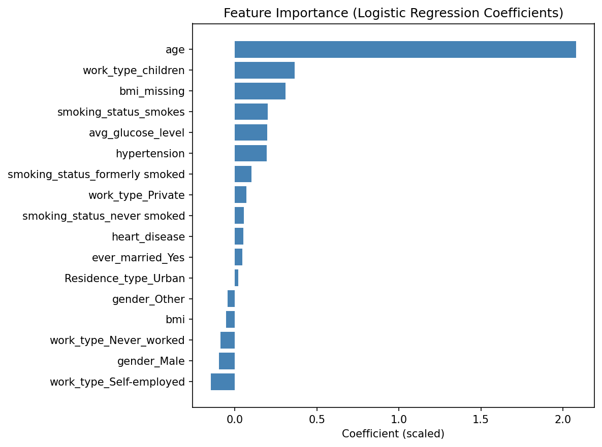

# Stroke Prediction: Summary & Conclusion

## Objective
Predict stroke risk from patient health and demographic data, with a focus on identifying at-risk individuals (high recall) given the clinical cost of missed cases.

## Data
- Source: Kaggle Stroke Prediction Dataset (5,110 patients, 12 features)
- Missing values: about 4% of BMI values, imputed with KNN imputation. A `bmi_missing` flag was kept.
- `smoking_status` contained about 30% "Unknown" values, largely explained by young patients who were never asked. It was kept as its own category rather than imputed.

## Key EDA Findings
- **Age** is the strongest predictor: stroke rate rises from about 0.2% (under 20) to about 20% (80+)
- **Hypertension** and **heart disease** roughly triple to quadruple stroke risk
- **Glucose level** shows a moderate positive relationship with stroke
- **BMI** shows little independent relationship with stroke
- **Work type** appeared predictive but is confounded by age (self-employed patients average 60 years old vs. 6.8 for children)

## Modeling Approach
- Class imbalance (95% no-stroke / 5% stroke) was addressed with SMOTE on the training set only
- Logistic Regression and Random Forest showed similar AUC (about 0.78-0.79), but Logistic Regression achieved much higher recall at matched thresholds
- A feature-scaling issue was found and fixed: unscaled logistic regression produced coefficients that contradicted the EDA (for example, hypertension appearing protective). Applying StandardScaler fixed this and improved AUC from 0.789 to 0.844.
- A threshold sweep (0.3 to 0.7) balanced recall against precision and accuracy, since the default 0.5 threshold is poorly suited to imbalanced classification

## Final Model
**Logistic Regression, scaled features, SMOTE-balanced training, threshold = 0.6**
- ROC-AUC: 0.844
- Recall (stroke): 0.76
- Precision (stroke): 0.17
- Accuracy: 0.81

## Interpretation
Age is by far the dominant predictor (scaled coefficient of about 2.1), followed by average glucose level and hypertension, which matches the EDA findings. Some features, such as `work_type_children` and `bmi_missing`, show elevated importance. This is likely caused by SMOTE interpolation artifacts rather than genuine clinical signal, so they should be interpreted cautiously.

## Limitations
- Precision remains low. In a real deployment this model would need to function as a *screening* tool (flagging patients for further review), not a diagnostic one.
- SMOTE-generated synthetic data may not perfectly reflect real patient distributions, especially for categorical features.
- The dataset is relatively small (5,110 rows), so results may not generalize without further validation.

## Possible Next Steps
- Try XGBoost or gradient boosting with proper hyperparameter tuning
- Explore cost-sensitive learning instead of SMOTE
- Validate on an external stroke dataset
